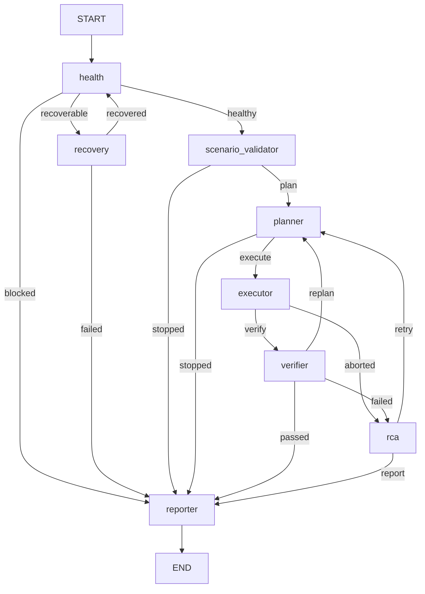

# Execution flow

How one run moves through files and functions, in the order things happen.
Each entry is written as `file:function`. Line numbers change over time, so
search for the function name instead.

Contents:

1. [Entry points](#1-entry-points)
2. [Runner start-up](#2-runner-start-up)
3. [The agent graph](#3-the-agent-graph)
4. [How every agent is called](#4-how-every-agent-is-called)
5. [Agent by agent](#5-agent-by-agent)
6. [Executor step loop](#6-executor-step-loop)
7. [Guided navigation](#7-guided-navigation)
8. [How a button press reaches the Xbox](#8-how-a-button-press-reaches-the-xbox)
9. [Learning flow](#9-learning-flow)
10. [Reporting flow](#10-reporting-flow)
11. [Gameplay flow (Dungeons)](#11-gameplay-flow-dungeons)
12. [Artifact timeline of a run](#12-artifact-timeline-of-a-run)

---

## 1. Entry points

The `xbox-agentic` command and `python console.py` both start at
`console.py:main`. `main` reads the arguments and calls one of these handlers:

| Command | Handler | What it calls next |
|---|---|---|
| `run <file\|text>` | `cmd_run` | `TestRunner(...)` → `runner.run(...)` → `print_report` → `verdict_exit_code` |
| `health` | `cmd_health` | `print_health`: runs only `HealthAgent` on the rig (no graph, no LLM, no API key needed) |
| `info` / `tools` | `cmd_info` / `cmd_tools` | prints the config, or the tools in the registry |
| `lessons list\|resolve` | `cmd_lessons` | `core/lesson_store.py` |
| `trends` | `cmd_trends` | `core/trends_report.py` |
| `interactive` | `cmd_interactive` | a REPL that calls `cmd_run` for each line |
| `dungeons` | `cmd_dungeons` | `tools/dungeons_gameplay.py:vision_guided_dungeons_gameplay_impl` directly (no graph, see section 11) |
| `play` | `cmd_play` | `gameplay/autonomous_player.py:AutonomousPlayer.play` (the older autonomous player, no graph) |

`--log-level` sets the environment variable `XBOX_AGENTIC_LOG_LEVEL`, which
`core/logging_setup.py:configure` reads later.

The source type comes from the first argument:

- `scenarios/*.yaml` → `"file"`
- `--requirement x.json` → `"requirement_file"`
- anything else → `"text"`

**Exit codes:** PASS 0, FAIL 1, BLOCKED 2, INCONCLUSIVE 3 (a dry run always
ends here), ERROR 4.

---

## 2. Runner start-up

`graph/runner.py:TestRunner.__init__`

1. `load_dotenv()` loads API keys from `.env`.
2. `Config.load_all(...)` loads `config/settings.yaml`, `config/agents.yaml` and `config/graph.yaml`.
3. `core/logging_setup.py:configure` sets up the console and `artifacts/logs/agentic.log`.
4. Creates `HardwareBridge` (`core/adapters.py`; it owns the pad and capture objects, opened lazily), `LLMFactory` and `PromptLibrary` (`prompts/*.md`).

`graph/runner.py:TestRunner.run(scenario_input, source)`

1. `core/artifacts.py:new_run_id` gives the run a unique id: `run-YYYYMMDD-HHMMSS[-n]`.
2. `ArtifactStore(run_id)` creates `artifacts/runs/<run_id>/` (with `screenshots/` and `reports/` inside).
3. `tools/registry.py:build_default_registry` collects `provide()` from every tool module (hardware, input, vision, navigation, report, game, minecraft, dungeons, coordinate, location memory, exploration, combat, health, skill memory, benchmark).
4. `agents/base.py:AgentContext` bundles the settings, config, hardware, LLMs, prompts, tools and artifacts. Every agent receives it.
5. `graph/builder.py:build_workflow` builds the graph (section 3).
6. `core/state.py:initial_state` creates the starting `AgenticState`.
7. `core/logging_setup.py:attach_run_log` copies all output into `<run_dir>/run.log`.
8. `workflow.invoke(state, recursion_limit=..., thread_id=run_id)` runs the agents.
9. A `finally` block calls `hardware.close()`, which always releases the serial port and the capture card.
10. Returns `final["report"]`, a `TestReport`.

`TestRunner._agent_factory(role)` finds the class for each role through the
`impl:` dotted path in `config/agents.yaml`. To swap an agent, change that path.

---

## 3. The agent graph

The graph is built by `graph/builder.py:WorkflowBuilder.build`:

- `add_node` once per entry in `config/graph.yaml`
- `add_edge(START, entry_point)`
- edges wired by `_wire_static` (the default) or by `_wire_supervised` (for `route_mode: supervised`)
- `compile(checkpointer=MemorySaver())`

The routing functions are in `graph/routing.py`.



| After node | Router | Returns |
|---|---|---|
| health | `route_after_health` | `healthy` / `recoverable` (recovery is enabled and under its limit) / `blocked` |
| recovery | `route_after_recovery` | `recovered` (goes back to health for a real re-check) / `failed` |
| scenario_validator | `route_after_scenario` | `plan` / `stopped` (halted or no scenario) |
| planner | `route_after_planner` | `execute` / `stopped` (halted or no plan) |
| executor | `route_after_executor` | `verify` / `aborted` (fatal step error or halted) |
| verifier | `route_after_verification` | `passed` / `replan` (`should_replan` and `replan_count` under the limit) / `failed` |
| rca | `route_after_rca` | `retry` (cause is retryable and under the limit) / `report` (`_pointless_to_retry`, limit reached, product defect, and so on) |

**Normal pass:** health → scenario_validator → planner → executor → verifier → reporter.

**Fail with one replan:** … → verifier(replan) → planner(r2) → executor → verifier(failed) → rca → reporter.

### State merging

Each agent returns a partial dict, and LangGraph merges it into `AgenticState`
using the reducers in `core/state.py`:

- `messages`, `artifacts` and `errors` are appended (`operator.add`).
- `agent_outputs` uses `merge_dicts`.
- `step_count`, `replan_count` and `recovery_count` use `keep_max`.
- All other keys (`plan`, `execution`, `verification` and so on) are replaced.

---

## 4. How every agent is called

`agents/base.py:BaseAgent.__call__(state)` wraps every node:

1. Prints `>>> [AGENT: <role>]`.
2. Calls `self.run(state)`, which each agent overrides.
3. Catches any exception and calls `_handle_error`. Errors go into `state.errors`; a fatal error sets `should_stop`.
4. Saves the output under `agent_outputs[<role>]`.

These helpers are used inside `run`:

| Helper | Does |
|---|---|
| `call_tool(name, **kw)` | `tools.build(name).func(**kw)`. This is the only way agents touch the hardware. |
| `render_prompt(state, **extra)` | Fills in `prompts/<role>.md` with `build_context` and the extra values. |
| `invoke_structured(Model, prompt, images)` | Calls the LLM, validates the reply with `Model.model_validate`, and retries if the reply is invalid. |

---

## 5. Agent by agent

Each line is a call made in order, with the file it writes shown after `→`.

### 5.1 Health: `agents/health_agent.py:run`

1. `_check_adapters` calls the tool `get_rig_status`.
2. `_check_gimx` calls `check_gimx_session` (the serial controller is reachable).
3. `_check_capture` calls `check_capture_device` (the capture card gives a non-blank frame).
4. → `health.json`

### 5.2 Recovery: `agents/recovery_agent.py:run`

Runs only when health returns `recoverable`.

1. `restart_gimx_session`
2. `check_capture_device`

### 5.3 Scenario validator: `agents/scenario_agent.py:run`

1. Loads the scenario by source type:
   - `"file"`: `_load_file` → `_from_yaml`
   - `"text"`: `_from_text` (LLM)
   - `"requirement_file"`: `_from_requirement` (LLM)
2. `_unresolved_controls` checks that every button name resolves through the tool `resolve_control`.
3. `_parse_stages` reads the `stages:` block, if there is one.
4. → `scenario.json`

### 5.4 Planner: `agents/planner_agent.py:run`

1. `is_replan` is true if a previous plan and verification already exist.
2. `core/lesson_store.py:open_lessons` loads open lessons for this scenario plus shared lessons for its surface tags; `prompt_view` formats them. → `lessons-applied-rN.json`
3. If this is **not** a replan **and** there are no open lessons, `core/route_store.py:load_cached_route` is checked. If a route was saved by an earlier pass, it is replayed with no LLM call → `plan-r1.json`, and the planner returns.
4. On a replan, `invalidate_cached_route` runs and the tool `read_screen_text` reads the current screen, so the new plan starts from where the console actually is.
5. `render_prompt` builds the prompt from the scenario, the lessons, the timings (`get_timing`) and the previous failure.
6. Up to 3 attempts:
   1. `invoke_structured(TestPlan)`
   2. `_fallback_staged_plan` if the scenario has stages and the plan does not cover them
   3. `_sanitise_plan`: rejects tools that are not allowed, then runs `_validate_stage_discipline`, `_validate_stage_coverage` and `_apply_navigation_guidance` (which injects the scenario's navigation settings)
   4. `_check_lessons_respected`: a plan that repeats a failing step without citing the lesson id is rejected, and the planner tries again
7. If every attempt fails, it uses a fixed fallback: `_fallback_staged_plan`, `_fallback_in_gameplay_plan`, or `_fallback_dungeons_plan` (chosen by tag).
8. → `plan-rN.json`. `replan_count` goes up when this is a replan.

### 5.5 Executor: `agents/executor_agent.py:run`

See [section 6](#6-executor-step-loop).

→ `execution.json`, `execution-rN.json`, `runtime-lessons-rN.json`, and screenshots in `screenshots/`.

### 5.6 Verifier: `agents/verifier_agent.py:run`

1. `_precheck` returns BLOCKED or INCONCLUSIVE straight away for dry runs, empty executions and fatal aborts.
2. `_oracle_evaluate` runs deterministic checks first (`text_present`, `no_error_dialog`, `screen_change`). If these settle every criterion, the LLM is not called.
3. `_gather_evidence` and `_select_images` (`encode_frame_for_vision`) pick the key frames.
4. `invoke_structured(VerificationResult, prompt, images)` is the vision LLM judgement.
5. `_normalise_verification_result` and `_merge_evidence` attach real file evidence to the verdict.
6. `_should_replan` decides whether one more plan is worth trying.
7. `_emit` → `verification.json`, `verification-rN.json`. Then:
   - PASS: `save_cached_route` and `lesson_store.resolve_all` (open lessons are marked resolved).
   - FAIL: `invalidate_cached_route`.
   - Replan: `_record_replan_lesson`.

### 5.7 RCA: `agents/rca_agent.py:run`

1. Checks the hardware again with `check_gimx_session` and `check_capture_device`.
2. `render_prompt` with `_timeline` (the step-by-step outcome).
3. `invoke_structured(RootCauseAnalysis)`
4. `_apply_guardrails`: `product_defect` is allowed only with proof (`_product_defect_evidence`); otherwise the cause is relabelled. → `rca.json`
5. `lesson_store.record_failure` saves the lesson. → `lesson-recorded-rN.json`

### 5.8 Reporter: `agents/reporter_agent.py:run`

1. `_resolve_verdict` picks the final verdict from verification, rca and errors.
2. `_executive_summary` (LLM) writes the plain-English summary.
3. Builds `TestReport`. → `state-digest.json`, `executive-summary.json`
4. `_age_lessons` calls `lesson_store.note_run`, which expires lessons after 3 quiet runs.
5. `_write` calls the report tools (section 10). → `reports/*`

### Supervisor (optional)

`agents/supervisor_agent.py` is used only with `route_mode: supervised`. It
picks `next_agent` instead of the static edges.

---

## 6. Executor step loop

`agents/executor_agent.py:run`

```text
run_deadline = now + execution_timeout
lessons = _load_applied_lessons(revision)          # from lessons-applied-rN.json
rules   = runtime_lessons.active_rules(lessons)    # guide_already_open, destination_already_open
_destinations = navigation targets from the scenario

for step in plan.steps[:max_steps]:
    1. deadline passed?                 -> stop, mark the rest skipped
    2. _guard_ingame_screen(results)    -> abort if a game is open unexpectedly
       (skipped when _dashboard_is_expected(scenario))
    3. focus unproven + confirm press   -> block the "A" press (_is_confirm_after_focus_move)
    4. _runtime_lesson_check(step, rules, lessons)
         runtime_lessons.needs_screen -> read the screen only if a rule could apply
         runtime_lessons.decide       -> skip the step if the lesson says it is redundant
    5. result = _execute_step(step, dry_run)
    6. _update_stage_tracking           -> current / last proven stage
    7. error and not optional and _is_fatal(result) -> abort (router sends to rca)
    8. dead-input streak: 3 unchanged screens in a row with no progress -> abort
       (_shows_positive_progress resets the streak)

ExecutionResult(...) -> execution.json, execution-rN.json, runtime-lessons-rN.json
```

`_execute_step(step)`:

1. `_capture("<i>-before-<action>")` takes a before-frame (skipped for `_OBSERVE_ONLY_ACTIONS` such as `capture_frame` and `read_screen_text`).
2. `_dispatch(step)` maps the step to its tool and calls `call_tool(...)`. The tool reply is saved as `COMMAND_ACK` evidence. It is not proof that the screen changed.
3. Observation:
   - Observe-only steps: `_adopt_own_observation` reuses the frame the tool returned.
   - All other steps: `_observe` (`wait_for_stable_screen`, `verify_screen_changed`, and `_verify_focus_target` after directional moves), then `_read_text` (OCR the after-frame).

---

## 7. Guided navigation

This is the tool `guided_navigate_to_text` in
`tools/navigation_tools.py:_guided_navigate_to_text`. It moves through a menu
until a named item is focused.

```text
for press in range(max_presses):
    captured = _settle(...)                 # wait until the frame is stable
    reading  = read_screen_text_impl(...)   # OCR (cached per frame)
    matched  = text_match.exact_matched_lines(text, target)
    focus    = _focus_matches(frame, target)  # detect_focus_highlight_impl
    if _is_page_heading(text, target): done  # the page is already open, so don't scroll
    if matched and (focus or not require_focus): done
    pad.press_times(direction, 1)           # one press, then look again
-> nav trace JSON (shown in the report's "Guided navigation" section)
```

Decisions about which button to press use `text_match` exact matching.
Fuzzy matching is used only to recognise which screen is showing
(`config/screen_signatures.yaml`).

---

## 8. How a button press reaches the Xbox

```text
executor._dispatch -> BaseAgent.call_tool("press_button", button="a")
  -> tools/input_tools.py:_press_button
       ctx.hardware.controls.resolve(button)        # config/controls.yaml alias -> canonical
       _pad(ctx) -> core/adapters.py:HardwareBridge.pad()
       pad.press_times(canonical, n, ...)
  -> ../Xbox-Automation-Python/test-controller/test_controller.py
       press_times -> press -> _send_event        # serial -> GIMX adapter -> Xbox
```

Frames go the other way: `tools/vision_tools.py` uses
`HardwareBridge`'s `ScreenCapture` (the capture card) and saves them into
`screenshots/`.

---

## 9. Learning flow

There are two kinds of memory: lessons, which come from failures, and routes,
which come from passes.

```text
FAIL run
  rca._apply_guardrails -> lesson_store.record_failure      -> artifacts/lessons/<id>.json
                                                               (+ _shared.json by surface tag)
NEXT run (same scenario, or a scenario sharing a surface tag)
  planner: open_lessons -> prompt_view -> prompt            (plan-time)
           _check_lessons_respected -> reject plans that repeat the failure
  executor: runtime_lessons.active_rules / decide           (run-time step skipping)
PASS run
  verifier._emit -> resolve_all (lessons resolved)
                 -> save_cached_route -> artifacts/routes/<id>.json
  next run with no open lessons replays the route (no LLM planning)
EVERY run
  reporter._age_lessons -> note_run (expires a lesson after 3 quiet runs)
```

Writes are protected by `core/store_lock.py:locked`, so parallel runs don't
lose updates. Manage lessons with `xbox-agentic lessons list|resolve`.

---

## 10. Reporting flow

```text
reporter._write
  -> tool write_scenario_report  -> tools/report_tools.py
       -> core/scenario_report.py:build_report(run_dir)
            load_run -> analyse -> markdown / html
            _professional_dashboard -> core/professional_report.py:render_dashboard(mode="scenario")
       -> reports/scenario-report.md, scenario-report.html
  -> tool write_mechanics_report (gameplay runs)
       -> gameplay/mechanics_report.py:build_report
```

Across runs, `xbox-agentic trends` calls `core/trends_report.py`, which reads
every `artifacts/runs/*/state-digest.json`.

---

## 11. Gameplay flow (Dungeons)

There are two ways in.

**A. Through the graph** (`xbox-agentic run scenarios/dungeons-*.yaml`):

The planner sees the Dungeons tag and uses `_fallback_dungeons_plan`, which
gives the steps `capture_frame` → `vision_guided_dungeons_gameplay`. The
executor runs that tool like any other step, and the verifier and reporter
then run as usual.

**B. Direct** (`xbox-agentic dungeons ...`):

`console.py:cmd_dungeons` calls
`vision_guided_dungeons_gameplay_impl` directly. There are no planner,
verifier or RCA agents.

Both ways then follow the same path:

```text
tools/dungeons_gameplay.py:vision_guided_dungeons_gameplay_impl
  resolve_profile(agents)          # game_profiles/dungeons_agents.PROFILE or dungeons_profile.PROFILE
  _load_learning(ctx)              # open lessons -> counters + prompt hint -> lessons-applied.json
  _with_lessons(profile, learning) # profile starts with the learned knobs
  _mirrored_pads / _encoder
  tools/gameplay_engine.py:run_gameplay_loop(ctx, profile, goal, ...)
     decider = build_vision_decider(ctx, profile.frame_model)
     loop per cycle:
        before = grab_nonblank(camera)
        image  = encode_frame(profile.prepare_vision_frame(before))
        decision = decide(decider, prompt, image)      # vision LLM -> frame_model
        profile.annotate_decision(decision, before)
        if profile.confirm_success(decision, counters): stop (goal reached)
        moves = profile.forced_moves(decision, counters)  # Supervisor overrides (stuck, low HP)
        profile.execute_moves(ctx, batch)  or  profile.execute_move(ctx, m)
             -> buttons from config/dungeons_controls.yaml
        after = grab_nonblank(camera)
        profile.update_stuck_counters(counters, moves, progressed)
  _finish_learning(ctx, result, learning)   # core/gameplay_lessons.py:update -> lessons-updated.json
  game_profiles/dungeons_agents.py:ReporterAgent().run(result, reports_dir)
     tools/dungeons_scenario_report.py:write -> professional_report.render_dashboard(mode="dungeons")
```

In `game_profiles/dungeons_agents.py`, `Supervisor` combines `HealthAgent`,
`CombatAgent`, `InteractionAgent` and `NavigatorAgent` through the profile
hooks.

**Gameplay learning** (`core/gameplay_lessons.py` + `tools/game_profiles/dungeons_learning.py`):

- At run end, `DungeonsRules.detect` reads the cycle log and records lessons in
  `artifacts/lessons/gameplay-dungeons.json`: `death` (with health before it),
  `not_attempted` (a chest/item/villager was close but never pressed), and
  `failed` (an agent acted but no later frame showed a result).
- At the next run's start, `adjustments` turns open lessons into bounded knobs:
  a death means drinking at 80% (85% after two) instead of 70%, and a
  not_attempted lesson makes `Supervisor._learned_interaction` give a close
  target to the interaction agent first. `prompt_text` adds a hint to every
  model prompt.
- Moves changed by a lesson are tagged `[learned]` and counted, so the report
  shows the lesson was enforced, not just loaded.
- A lesson is resolved when its scenario later PASSes. It ages when it doesn't
  recur and expires after 3 quiet runs. Runs shorter than 10 in-mission cycles
  don't judge it at all.

To add a new game, create a new `GameProfile`; see
[ADDING_GAMEPLAY.md](ADDING_GAMEPLAY.md).

---

## 12. Artifact timeline of a run

Files appear in `artifacts/runs/<run_id>/` in this order:

| # | File | Written by |
|---|---|---|
| 1 | `run.log` | runner (`attach_run_log`), stays open for the whole run |
| 2 | `health.json` | health |
| 3 | `scenario.json` | scenario_validator |
| 4 | `lessons-applied-r1.json` | planner |
| 5 | `plan-r1.json` | planner |
| 6 | `screenshots/*.png`, nav traces | executor and tools |
| 7 | `execution.json`, `execution-r1.json`, `runtime-lessons-r1.json` | executor |
| 8 | `verification.json`, `verification-r1.json` | verifier |
| (9) | `lessons-applied-r2.json` … `verification-r2.json` | replan loop, if any |
| (10) | `rca.json`, `lesson-recorded-rN.json` | rca, on failure only |
| 11 | `state-digest.json`, `executive-summary.json` | reporter |
| 12 | `reports/scenario-report.md`, `reports/scenario-report.html` | reporter → report tools |

Files outside the run folder:

- `artifacts/lessons/` (written on fail, resolved on pass)
- `artifacts/routes/` (written on pass)
- `artifacts/logs/agentic.log` (every run)

To debug a run, read the files in this order. The first file that looks wrong
shows which agent to look at.